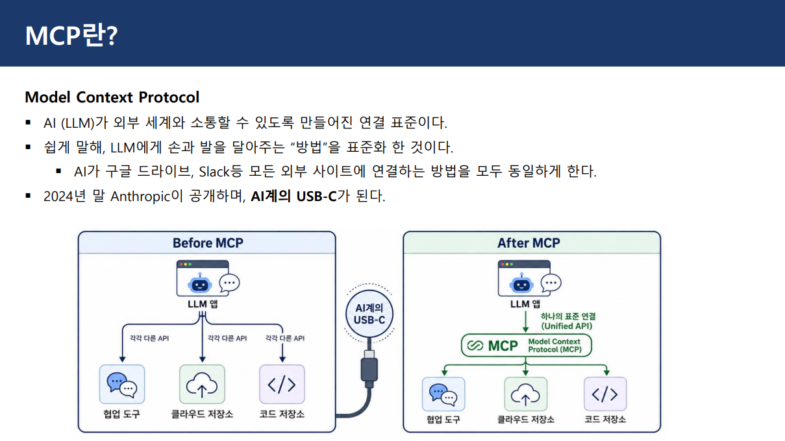

# 이미지 및 GIF 미리보기

> 이 폴더에 저장된 이미지 파일의 자동 생성 갤러리입니다.
> 원본 파일은 각 미리보기를 클릭해 열 수 있습니다.

## a 주사위 굴리기 문제

`01_a-주사위-굴리기-문제.png`

## b 주사위 굴리기 결과

`02_b-주사위-굴리기-결과.png`

## a 날씨 API 호출하기 문제

`03_a-날씨-API-호출하기-문제.png`

## a 날씨 API 호출하기 문제

`04_a-날씨-API-호출하기-문제.png`

## c 날씨 API 호출하기 결과

`05_c-날씨-API-호출하기-결과.png`

## c 날씨 API 호출하기 결과

`06_c-날씨-API-호출하기-결과.png`

## C MCP Model Context Protocol

`07_C-MCP-Model-Context-Protocol.png`
