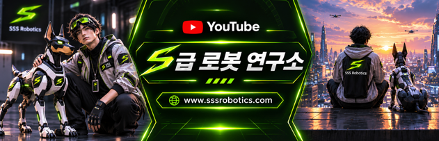

# 이미지 및 GIF 미리보기

> 이 폴더에 저장된 이미지 파일의 자동 생성 갤러리입니다.
> 원본 파일은 각 미리보기를 클릭해 열 수 있습니다.

## DLI 02 Building Your First Rob

`01_DLI-02-Building-Your-First-Rob.png`

## DLI 02 Building Your First Rob

`02_DLI-02-Building-Your-First-Rob.png`

## DLI 02 Building Your First Rob

`03_DLI-02-Building-Your-First-Rob.png`

## 3 2 Cube 낙하 실습

`04_3-2-Cube-낙하-실습.png`

## 3 2 Cube 낙하 실습

`05_3-2-Cube-낙하-실습.png`

## 4 1 로봇 몸체 구성

`06_4-1-로봇-몸체-구성.png`

## 4 2 바퀴 구성

`07_4-2-바퀴-구성.png`

## 5 2 Differential Controller란

`08_5-2-Differential-Controller란.png`

## 6 2 키보드 조종 실습

`09_6-2-키보드-조종-실습.png`

## 회고 및 다음 과제 RetropectiveNext St

`10_회고-및-다음-과제-RetropectiveNext-St.png`

## 참고 문헌 References

`11_참고-문헌-References.png`

## 문의하기 Contact us

`12_문의하기-Contact-us.png`

## 문의하기 Contact us

`13_문의하기-Contact-us.png`
