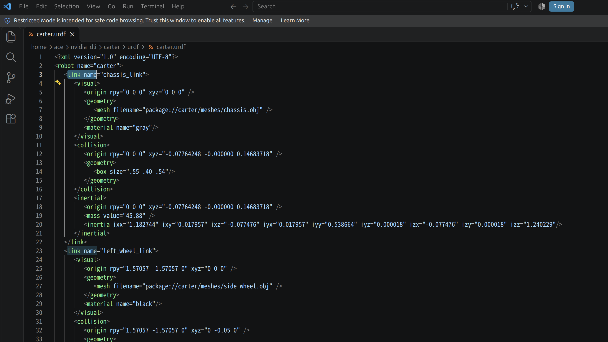

# 이미지 및 GIF 미리보기

> 이 폴더에 저장된 이미지 파일의 자동 생성 갤러리입니다.
> 원본 파일은 각 미리보기를 클릭해 열 수 있습니다.

## DLI 4일차 DAY 03 Ingesting Robot

`01_DLI-4일차-DAY-03-Ingesting-Robot.png`

## DLI 4일차 DAY 03 Ingesting Robot

`02_DLI-4일차-DAY-03-Ingesting-Robot.png`

## DLI 4일차 DAY 03 Ingesting Robot

`03_DLI-4일차-DAY-03-Ingesting-Robot.png`

## 1 1 URDFUnified Robot Descript

`04_1-1-URDFUnified-Robot-Descript.png`

## 2 2 Carter 로봇 가져오기

`05_2-2-Carter-로봇-가져오기.png`

## 3 1 바닥 환경 구성

`06_3-1-바닥-환경-구성.png`

## 3 3 바퀴 회전 실습

`07_3-3-바퀴-회전-실습.png`

## 5 3 장애물 환경 구성

`08_5-3-장애물-환경-구성.png`

## 5 4 2D LiDAR 장착

`09_5-4-2D-LiDAR-장착.png`

## 6 1 Nova Carter란

`10_6-1-Nova-Carter란.png`

## 6 2 Nova Carter의 센서 구성

`11_6-2-Nova-Carter의-센서-구성.png`

## 6 3 Carter와 Nova Carter 비교

`12_6-3-Carter와-Nova-Carter-비교.png`

## 6 3 Carter와 Nova Carter 비교

`13_6-3-Carter와-Nova-Carter-비교.png`

## 6 3 Carter와 Nova Carter 비교

`14_6-3-Carter와-Nova-Carter-비교.png`

## 회고 및 다음 과제 RetropectiveNext St

`15_회고-및-다음-과제-RetropectiveNext-St.png`

## 참고 문헌 References

`16_참고-문헌-References.png`

## 문의하기 Contact us

`17_문의하기-Contact-us.png`

## 문의하기 Contact us

`18_문의하기-Contact-us.png`
