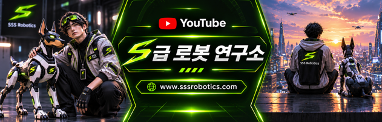
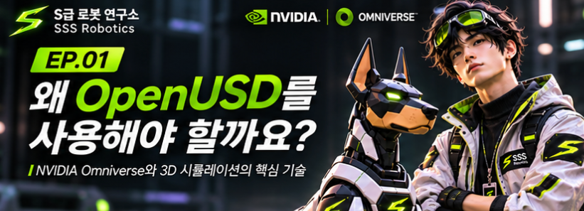

# 이미지 및 GIF 미리보기

> 이 폴더에 저장된 이미지 파일의 자동 생성 갤러리입니다.
> 원본 파일은 각 미리보기를 클릭해 열 수 있습니다.

## DLI 05 Best Practices for Robo

`01_DLI-05-Best-Practices-for-Robo.png`

## DLI 05 Best Practices for Robo

`02_DLI-05-Best-Practices-for-Robo.png`

## DLI 05 Best Practices for Robo

`03_DLI-05-Best-Practices-for-Robo.png`

## 로봇 핸드 불러오기

`04_로봇-핸드-불러오기.png`

## 2 3 메시 정리와 위치 조정

`05_2-3-메시-정리와-위치-조정.png`

## 로봇 핸드 옵티마이즈 작업 진행 중

`06_로봇-핸드-옵티마이즈-작업-진행-중.png`

## 2 5 최적화 결과 확인

`07_2-5-최적화-결과-확인.png`

## 2 5 최적화 결과 확인

`08_2-5-최적화-결과-확인.png`

## 사용하려는 로봇은 Universal Robots UR1

`09_사용하려는-로봇은-Universal-Robots-UR1.png`

## 지금 진행하는 작업의 핵심은 ROS 2에 등록된 로봇의

`10_지금-진행하는-작업의-핵심은-ROS-2에-등록된-로봇의.png`

## 3 3 Isaac Sim에서 UR10e 가져오기

`11_3-3-Isaac-Sim에서-UR10e-가져오기.png`

## 3 4 URDF Import 결과 확인

`12_3-4-URDF-Import-결과-확인.png`

## 4 2 그리퍼 에셋 가져오기

`13_4-2-그리퍼-에셋-가져오기.png`

## 4 2 그리퍼 에셋 가져오기

`14_4-2-그리퍼-에셋-가져오기.png`

## 5 1 학습 장면 구성하기

`15_5-1-학습-장면-구성하기.png`

## 5 3 로봇과 작업물 배치

`16_5-3-로봇과-작업물-배치.png`

## 6 1 IK란

`17_6-1-IK란.png`

## 회고 및 다음 과제 RetropectiveNext St

`18_회고-및-다음-과제-RetropectiveNext-St.png`

## 참고 문헌 References

`19_참고-문헌-References.png`

## 문의하기 Contact us

`20_문의하기-Contact-us.png`

## 문의하기 Contact us

`21_문의하기-Contact-us.png`
